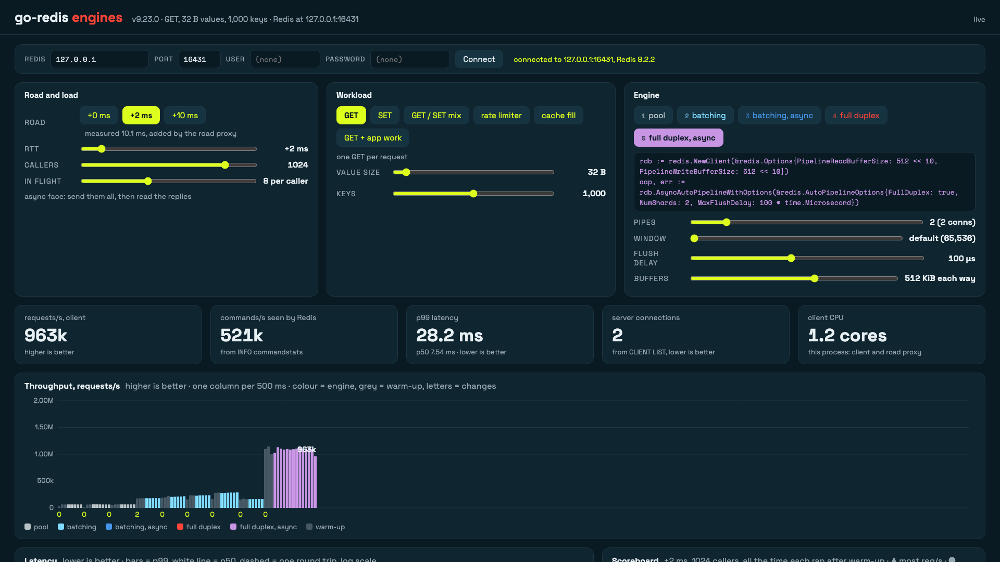
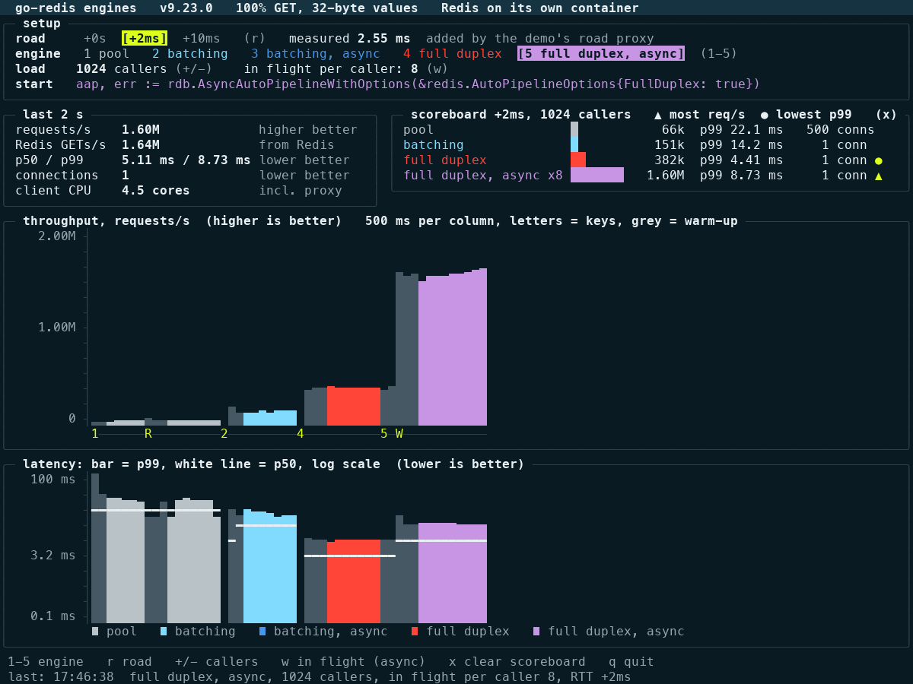

# go-redis road test

The demo from the talk "The logistics of a database client". A terminal and browser demo of the three ways [go-redis](https://github.com/redis/go-redis) can carry commands
to Redis. Each engine has a blocking face and, for the autopipelining engines, an async face:

| Key | Engine | Start |
|-----|--------|-------|
| `1` | pool | `redis.NewClient(&redis.Options{PoolSize: 500})` |
| `2` | batching | `rdb.AutoPipeline()` |
| `3` | batching, async | `rdb.AsyncAutoPipeline()` |
| `4` | full duplex | `rdb.AutoPipelineWithOptions(&redis.AutoPipelineOptions{FullDuplex: true})` |
| `5` | full duplex, async | `rdb.AsyncAutoPipelineWithOptions(&redis.AutoPipelineOptions{FullDuplex: true})` |

The same lines, as runnable functions, are in [`core_usage.go`](core_usage.go).

The demo runs a load of N callers. Each caller keeps one `GET` in flight on the blocking faces, or a
window of them on the async faces, against 1000 keys with 32-byte values. You switch the engine, the
road and the load while it runs, and watch throughput, latency and the connections Redis holds.

**The road.** Client and Redis run on one machine, so the demo puts a small proxy between them. Every
engine connection goes through it, and it holds each chunk for RTT/2 in each direction. Many chunks
are on the road at once, as on a real network: the proxy never waits for one chunk before reading the
next, which would slow every engine down to one trip at a time. `r` changes the added round trip
(0, 2 or 10 ms) while the load runs. The **measured** RTT is the median of PINGs through the proxy on
one connection.

**What is measured where.** Requests per second and p50/p99 are counted in the client, per request.
The truth comes from Redis, read on a separate connection that does not go through the road:

- **GETs/s seen by Redis**: the `cmdstat_get` delta from `INFO commandstats`. It should match the
  client's count.
- **Server connections**: `CLIENT LIST` entries named `demo-engines-<pid>`. Every engine connection
  sets that name, with this process's id, so two demos on one Redis do not count each other; the
  demo's own probe and stats connections use other names.

## Install

Requires Go 1.26 or newer. The browser page is built into the binary, so the binary is all you need
on the machine that runs the load.

```bash
go install github.com/ndyakov/go-redis-road-test@latest
go-redis-road-test --web 127.0.0.1:8080 --addr redis-host:6379
```

`go install` puts the binary in `$(go env GOPATH)/bin`; add that directory to your `PATH`. It builds
against the go-redis version pinned in `go.mod` (v9.23.0). To try another go-redis version, clone
the repository and use `run.sh` (see [Any go-redis version](#any-go-redis-version)).

**On a cloud client instance.** Run the demo on a machine close to your Redis, so the numbers show
your network and not your laptop's. The web page has no login, so keep it on `127.0.0.1` and reach
it through an SSH tunnel:

```bash
# on your laptop
ssh -L 8080:127.0.0.1:8080 user@client-instance
# on the client instance (the --addr is where your Redis is)
REDIS_PASSWORD=... go-redis-road-test --web 127.0.0.1:8080 --addr redis-host:6379 --user default
```

Then open http://127.0.0.1:8080 on your laptop. Add `--direct` when Redis is already across a real
network: the demo then connects straight to it, without its road proxy, and the RTT setting does
nothing.

**From a clone:**

```bash
git clone https://github.com/ndyakov/go-redis-road-test.git
cd go-redis-road-test
go run . --web 127.0.0.1:8080
```

The rest of this README uses `go run .`; with an installed binary, run `go-redis-road-test` with the
same flags.

**Release binaries.** `scripts/release.sh v0.1.0` builds Linux (amd64, arm64) and macOS (arm64,
amd64) binaries into `dist/`, one `.tar.gz` each with a `SHA256SUMS` file. With `--publish` it also
creates a signed tag, pushes it and creates the GitHub release with those files. A machine without
Go can then download one and run it.

## 1. Redis

The demo connects to `localhost:6379` by default. Point it at any Redis you like: with flags, or in
the browser UI's Redis panel (host, port, user, password), which checks the new server before it
switches and keeps the old one if that fails.

```bash
go run . --web 127.0.0.1:8080 --addr localhost:6379            # any Redis
REDIS_PASSWORD=... go run . --web 127.0.0.1:8080 --user default # with a password
```

The password is read only from `REDIS_PASSWORD` (a flag would show in `ps`), or typed in the browser
UI; the page never gets it back.

**What the demo does to that Redis:** it writes keys named `demo:key:*`, `demo:rl:*` and
`demo:page:*`, and puts heavy load on it. It never runs `FLUSHDB` or deletes other keys. Do not point
it at a Redis that other people or test runs depend on.

For a Redis of its own, there is a container:

```bash
docker compose up -d --wait        # Redis 8.2 on host port 16421
go run . --addr 127.0.0.1:16421
```

For large values, run Redis natively instead (see below): Docker Desktop's port forwarding limits
bandwidth.

## Any go-redis version

`go.mod` pins v9.23.0. To try another go-redis without editing it, use `run.sh`: it builds the demo
against the version you name in a scratch copy, then runs it. Everything after the version goes to
the demo.

```bash
./run.sh v9.24.0 --web 127.0.0.1:8080     # a release, when it is out
./run.sh latest --scripted
./run.sh master --web 127.0.0.1:8080      # a branch or a commit
./run.sh ../go-redis --web 127.0.0.1:8080 # a local checkout: unreleased code
```

The version the binary was built with is shown in both UIs and in the tours, read from the binary
itself (`local v9.23.0-124-g78e7fa89` for a checkout). Running two versions side by side works: start
each on its own web port, against the same Redis; each counts only its own connections.

Options that only some versions have are picked at build time. Today that is the number of
full-duplex pipes: v9.23.0 calls it `NumShards`, v9.24 adds `FullDuplexPipes`. `run.sh` looks for
the field in the go-redis source and builds with `-tags goredis_fdpipes` when it is there
(`pipes_fdpipes.go`, else `pipes_numshards.go`); the start code on screen uses the same name. A new
option in a later release follows the same pattern: one small file per side of the build tag, and one
check in `run.sh`.

## 2. Run

Requires Go 1.26 or newer (go-redis v9.23.0 requires it).

```bash
go run .                 # interactive, in the terminal
go run . --web 127.0.0.1:8080   # the same demo in a browser: open http://127.0.0.1:8080
go run . --scripted      # hands-free tour: every engine on four roads, prints a table, exits
go run . --addr host:port --user name   # password: REDIS_PASSWORD
go run . --rttcheck      # where the round trip goes: timer, Docker, the road, CPU under load
go run . --leakcheck     # stops the pool while it dials; every connection must be gone after
```

Use a large terminal, 120 columns by 45 rows or more. For a projector, the browser UI (`--web`) is
easier to read; it is laid out for 1920 x 1080. Without scrolling it shows the engine (with the go-redis
version), road and load (with the live or warming-up status), workload, a row of compact numbers
(requests/s, p99 with p50, connections, errors, and delayed with its threshold buttons; hover a card
for its details), the throughput and latency charts at one size with "blocked in the client" and the
scoreboard next to them (the most req/s and lowest p99 on top, the rest scroll). The Options drawer (workload and engine sliders)
sits right under the engine row; the constructor line, Experiments (which also holds the go-redis
OpenTelemetry panel) and Connection are collapsible too,
and each remembers whether it is open. The road is set with the RTT slider (`r` cycles +0, +2, +10 ms).
Redis commands/s and client CPU are at the bottom. The charts and the scoreboard explain their marks
in an (i) tooltip. `?open` opens every drawer, for screenshots.

### Browser UI: experiments

| Experiment | What it does | What it showed (laptop, +2 ms, 256 callers unless noted) |
|------------|--------------|-----------------------------------------------------------|
| Find the best setup | one button: the blocking faces (pool, batching with 1, 2 and 4 connections, full duplex with 1, 2 and 4 pipes, full duplex with MaxFlushDelay 250 µs) and the async faces with one request in flight (batching async x1, full duplex async x1 with 1 and 2 pipes and with delay 250 and 500 µs: a request's own commands still go out together, as in the rate limiter and the page). With "more in flight per caller" checked (remembered) also batching async x2, x4, x8 and full duplex async x2, x4, x4 with 2 pipes, x4 with delay 250 µs, x8, x8 with 2 pipes: 13 or 22 setups. The delay setups override the Options delay; the others keep it. Leave it off when your app cannot keep several requests in flight per caller on the current road, workload, callers or open-loop rate, 4 s each after warm-up. A table with req/s, p50, p99, CPU seconds per million requests, heap, connections and errors, and the best for p99, CPU, memory and req/s. A setup with errors, or behind schedule in open loop, cannot win; ties go to more req/s (p99) or lower p99 (the rest). Before each setup's warm-up it collects the last setup's garbage and returns it to the OS, so each starts from the same heap. It takes over the engine, in flight, pipes and batching connections and puts them back; the client options stay as set | +2 ms, 64 callers, GET: most req/s full duplex async x64 (1.05M, p99 5.4 ms), lowest p99 full duplex async x8 (4.0 ms at 217k), least CPU batching async x64 (2.4 CPU-s per 1M), least memory full duplex (8 MB) |
| Open loop | requests are scheduled at a target rate; latency starts at the scheduled time. When the client falls more than 100 ms behind, the status line and the delayed card say "open loop: N behind schedule" in red | 50k/s target: 50,002/s, p99 4.2 ms. 2M/s target (over the 110k this setup can do): the schedule falls behind, p50 3.5 s. Closed loop would have shown a lower rate and a good p99 |
| Client cores | `GOMAXPROCS` | full duplex async x8, MaxFlushDelay 250 µs vs off. 1 core: +59% at +0 (956k vs 600k), +23% at +2 ms. 14 cores: +4 to +9%, about noise: with spare cores the writer already sends full batches |
| Faults | kill the engine's connections; big replies through the engine (1 MB, 10 MB, 10 MB x10 at once, 50 MB, 1 MB x100 at once); a 2 s BLPOP | kills: no errors, go-redis retries and reconnects. Big replies: the event line gives the fastest, median and slowest GET; the p99 chart shows what the other requests waited. 10 MB x10: pool 81 to 550 ms, full duplex 51 to 484 ms. BLPOP: full duplex runs it on a second connection |
| Errors in the events log | new errors, and new out-of-order replies in the ordering check, as an ERROR line: how many since the last line and the last error, at most every 2 s | pool with MaxActiveConns 10 below PoolSize: "ERROR 13091 new errors, last: redis: connection pool exhausted" |
| Ordering check (workload) | each caller INCRs its own key; a reply that is not the last + 1 is out of order. Shown on the errors card ("out of order: N" in red, or "all in order") and in the status line; such a scenario is marked ✕ on the scoreboard and in the finder and cannot be the best. Only the async faces with more than one in flight per caller and unordered batching (more than one batch at once) can reorder | async x8: unordered batching (4 at once) 1.7M out of order in 6 s; ordered batching, full duplex with 1 or 4 pipes: 0 |
| Client memory | Go heap in use, and what the runtime holds from the OS, on the CPU card | full duplex about 10 MB heap, the 256-connection pool about 40 MB |
| go-redis OpenTelemetry | off by default. On: `extra/redisotel-native` with an in-process `ManualReader`, read every tick: `db.client.operation.duration` (per second, mean, p50, p99), connection count by pool, pending requests, pool wait and dial times, errors, closed connections | the pool and full duplex record each command; batching records each batch as `PIPELINE`, with its size. Cost, 256 callers: pool about -4%, batching none, **full duplex 10x lower** (1.86M to 178k req/s at +0, async x64; 655k to 169k at +2 ms, x8). Cause: for every reply the full-duplex reader runs the metric callback inline, with `enterNodeDispatch` (`curGoroutineID`, which calls `runtime.Stack`), so the one reader goroutine is the limit. Fixed on go-redis master after v9.23.0 (PR #4269): the reader no longer pays that cost per reply. On v9.23.0, compare engines with OTel off |

### Browser UI: sliders and workloads

The browser UI has three panels of controls. Every change restarts the engine, and the scoreboard
keeps a separate best for every load, so you compare engines on the same load.

| Panel | Control | Range | What to try |
|-------|---------|-------|-------------|
| Road and load | RTT | 0 to 20 ms, presets 0 / 2 / 10 | the pool and batching lose with every ms; full duplex stays near callers / RTT |
| | callers | 1 to 4096 | up to ~64 the engines are close; the gap opens above |
| | in flight per caller | 1 to 256, async faces | at 1 async equals blocking; more fills the trip, and past the window it queues |
| Workload | GET, SET, GET / SET mix | write share 0 to 100% | the mix changes little for one shard |
| | rate limiter | INCRBY + EXPIRE NX | blocking faces pay two trips, async one: 2x |
| | cache fill | GET, then SET from its reply | a pipeline cannot merge them; async does not wait for the SET: 2x |
| | page render | 1 to 50 keys per page, app work 0 to 20 ms | blocking: one GET after the other (N round trips), then the work. Async: all N GETs at once, the work while they travel, one wait |
| | value size | 16 B to 1 MiB (1,000 keys; the key count is no longer a slider, the API still takes `keys`) | large values need more pipes (see below) |
| | GET: `Get` (default) or `GetToBuffer` (GET and the GET / SET mix) | a buffer per request in flight, value size + 2 bytes | `GetToBuffer` reads the value into the buffer, with no string per reply. It opts out of retries, so a killed connection shows as errors. Measured on AWS, 32 to 50 KB values: Go GC CPU 13% to 0%, client CPU 6 to 13% lower, RSS about 33% lower, throughput the same |
| Engine: pool | PoolSize | 1 to 2000 | throughput follows connections / RTT |
| | MinIdleConns | 0 to 2000 | connections dialed ahead: no dial burst when the load starts |
| | MaxActiveConns | no limit (default) to 2000 | a hard cap on connections; see the note below |
| | Read/WriteBufferSize | default (32 KiB) to 1 MiB | for large values |
| Engine: batching | MaxBatchSize | default (200; 300 on the blocking face) to 20,000 | bigger batches, fewer trips |
| | MaxBatchBytes | default (128 KiB) to 64 MiB | a batch also stops at this many bytes. Measured on AWS, 80% GET / 20% SET of 1 KB values, +10 ms, 4096 callers: 43k req/s at the default (below the 500-connection pool's 49k), 203k at 16 MiB. Not applied to full duplex: there it is a guardrail |
| | NumShards (connections), blocking face only | 1 to 16 | one connection each. The async face would need `Unordered: true`; on the blocking face each caller waits for its reply, so its order holds. Any change moves off `rdb.AutoPipeline()`, so MaxBatchSize is then 200, not 300. Measured on AWS, same zone, 32 B, 4096 callers: 1 connection 1.58M req/s, 2 2.63M, 4 2.72M; at +2 ms, 712k with 1 and 976k with 4, p99 9.8 to 5.8 ms. With few callers more connections are slower: smaller batches |
| | MaxConcurrentBatches | 1 (ordered) to 16 | more than one sets `Unordered: true`: commands lose their submit order |
| | MaxQueuedCommands | no limit to 1M | past it, commands fail with `ErrAutoPipelineQueueFull`: watch the errors |
| Engine: full duplex | NumShards (pipes) | 1 to 16 | one connection each; for large values |
| | MaxFlushDelay | off to 2 ms | helps a CPU-starved client; costs latency otherwise |
| | FullDuplexWindow | default (65,536) down to 16 per pipe | full duplex's queue limit: a full window blocks the submitter, it does not fail. The blocked card says "full, submitters wait" |
| Engine: both pipelined | PipelineRead/WriteBufferSize | default (128 KiB) to 4 MiB | the pipeline pool's buffers |
| Client options (every engine; the panel is hidden in the page, remove `hidden` from `#client-options` to show it, the API still takes them) | Protocol | RESP3 (default) or RESP2 | reply parsing |
| | PoolTimeout | the demo's 30 s, or 10 ms to 5 s | how long a caller waits for a connection before it fails |
| | MaxRetries | default (3), none, 1, 10 | retries on a retryable error |
| | Read/WriteTimeout | the demo's 10 s, or 50 ms to 3 s | fail fast instead of waiting |
| | ConnMaxLifetime | no limit (default), 500 ms to 60 s | connection churn: the reconnect cost shows (pool, 64 callers, 2 s: about half the req/s) |
| | DisableIdentity | on (default) or off | skips CLIENT SETINFO on a new connection |
| | GOGC | 25 to 800, default 100 | this process's Go GC: CPU against memory, for the finder's CPU and memory columns |

The start line under the engine is generated from these options: it is the Go that builds what runs.
With nothing changed it is `rdb.AutoPipeline()`, the no-options constructor, and the demo calls exactly
that (its blocking preset uses MaxBatchSize 300, where zero-value options would mean 200).

**MaxActiveConns below PoolSize does not make callers wait** (v9.23.0 and master). The pool hands out
up to PoolSize turns, and past MaxActiveConns connections a turn fails at once with
`redis: connection pool exhausted`: with PoolSize 500 and MaxActiveConns 50, 1024 callers got about
100k errors a second. With PoolSize at MaxActiveConns or below, callers wait as the option's doc
describes. The UI says which of the two you have.

**Batching's MaxQueuedCommands has no full-duplex twin.** With full duplex it limits only commands
that run outside the pipeline; the stream itself is bounded by FullDuplexWindow, which blocks instead
of rejecting.

**Warm spares have no name yet.** The pool dials a spare but sets it up (HELLO, CLIENT SETNAME) on first
use, so it shows in `CLIENT LIST` with no name and no command. The connections card counts those as
"+ N idle, no name yet"; another idle client with no name would count there too.

Left out on purpose: `FullDuplexIdleTimeout` and `FullDuplexMaxHold` (how often the held connection
goes back to the pool so re-auth and maintenance hooks run: correctness, not speed), and
`PoolTimeout`, `ConnMaxIdleTime` and the dial retries, which do not change these numbers.

Changing the value size or the keys re-seeds the keys first (up to 256 MB in total).

**Large values.** Docker Desktop's port forwarding stops near 1.7 Gbit/s, so 4 KB values look slow on
the container. Run Redis natively for them, and point the demo at it:

```bash
redis-server --port 16431 --save "" --appendonly no --maxclients 10000
go run . --web 127.0.0.1:8080 --addr 127.0.0.1:16431
```

On a Mac, one connection then carries about 1.5 Gbit/s of 4 KB values even with `--direct` (no road
proxy): a per-connection limit of the loopback, the laptop's version of the per-flow limit on AWS.
More pipes scale it: 4 pipes did 120k requests/s (4 Gbit/s) where 1 did 46k.

`--direct` connects the engines straight to Redis, without the road proxy. The RTT setting then does
nothing; use it to see what the proxy itself costs (mostly CPU with many connections).

### Browser UI



`--web` serves the same demo as a web page: buttons for the road, the engine, the callers and the
requests in flight, the same numbers as cards, larger throughput and latency charts, and the
scoreboard. The keys work the same (`1`-`5`, `r`, `+`, `-`, `w`, `x`). The page is built into the
binary and loads nothing from the internet, so it works offline. It listens on `127.0.0.1` unless you
give another address; there is no login, so do not expose it to a network you do not trust.



What is on screen:

- **Setup**: the road (the added RTT, highlighted, and the RTT measured through it), the five engines
  with the selected one highlighted, the load, and the one line of code that starts the engine.
- **Last 2 s**: requests/s in the client and in Redis, p50 and p99, server connections, and the CPU
  this process used. That CPU includes the road proxy, which runs in the same process.
- **Scoreboard**: every engine you ran on the current road and load, over all the time it ran there
  after warm-up: requests/s is the total over that time, and p50 and p99 come from every request, so a
  bad moment stays in the tail. The run time is shown next to each row. Two rows are marked, never one:
  ▲ the most requests/s and ● the lowest p99. More in flight can buy throughput with a long tail, and
  that is not the best for every app. Run one demo per machine: two demos share the CPU and slow each
  other.
- **Road ceiling** (under requests/s): the most this setup can do on the road from round trips
  alone: requests in flight (for the pool, capped by its connections) over the time each needs. That is
  1 round trip, or 2 on the blocking faces for the rate limiter and the cache fill. For "page
  render": N round trips plus the work on the blocking faces, one round trip overlapped with the work
  on async. A measured number at or below it is plausible; the percentage says how much of it the CPU, the proxy
  and the timers let through. At +0 there is no road ceiling: the CPU decides.
- **Same window everywhere:** requests/s, Redis's commands/s and the client CPU all cover the same
  last 2 s after warm-up, so commands per request reads exactly 1 or 2.
- **Errors, blocked, delayed** (browser UI):
  - errors per second by kind (queue full, timeout, connection, other), the total since the engine
    started, and the last message; a red mark under each chart column that had errors;
  - blocked in the client: commands accepted by the autopipeliner but not yet sent
    (`AutoPipeliner.Len()`), or for the pool the callers waiting for a connection right now
    (`PoolStats().PendingRequests`), with pool waits per second, the average wait and wait timeouts;
    and requests in flight against callers x in flight per caller;
  - delayed: the share and rate of requests slower than a threshold, by default 2 round trips + 1 ms
    (5, 10, 50 and 100 ms to pick).
- **Throughput**: requests/s, one column per 500 ms, coloured by the engine that ran. The letters under
  the chart are the keys you pressed, so cause and effect line up. Grey columns are the warm-up: the
  first 1.5 s after any change, while the pool dials and every connection does its `HELLO` through the
  road. They are left out of the panels and the scoreboard.
- **Latency**: p99 as bars and p50 as a white line, on a log scale, on the same time axis.
- **Footer**: the keys, and the last event.

The charts and panels size themselves to the terminal; 120 x 45 or larger works best.

Keys:

| Key | Action | What to watch |
|-----|--------|---------------|
| `1`-`5` | switch engine | server connections: the pool opens up to 500, batching and full duplex hold 1 |
| `r` | road: +0, +2, +10 ms | the pool and batching drop with every millisecond; full duplex stays near callers / RTT, with p99 near one round trip |
| `+` `-` | callers: 1 (the start), 16, 64, 256, 1024, 4096 | at 64 callers or fewer the engines are about the same; the difference starts above that |
| `w` | requests in flight per caller on the async faces: 1, 8, 64 | at 1 the async face equals the blocking face; at 8 one caller fills the trip. At 64 with 1024 callers, 65,536 requests are in flight: the full-duplex window (`FullDuplexWindow`, 65,536 by default) is full, so callers wait to submit. Throughput goes up a little, p99 goes up a lot: queueing, not the road |
| `x` | clear the scoreboard | |
| `q` | quit | |

Colour is used throughout but never alone: every value has a word and a "higher is better" or "lower
is better" note, and actions in the strip are letters. `NO_COLOR=1` turns colour off.

## What to expect

A run of `--scripted` on a laptop (Apple M-series, 14 cores, Docker Desktop), 1024 callers, one request
in flight each. "Road RTT" is a PING through the road, measured while that engine runs.

| Road | pool (500 connections) | batching (1) | full duplex (1) |
|------|------------------------|--------------|-----------------|
| +0 ms | 66k, p99 27 ms | 640k, p99 4.2 ms | 909k, p99 3.3 ms |
| +2 ms | 59k, p99 30 ms (road RTT 11 ms) | 154k, p99 14 ms | 384k, p99 4.4 ms (road RTT 1.9 ms) |
| +10 ms | 41k, p99 33 ms | 47k, p99 38 ms | 95k, p99 14 ms |

With 8 requests in flight per caller, async full duplex reached 1.6M requests/s on +2 ms, on one
connection. At 64 callers the engines are close: 22-28k on +2 ms.

The order matches what the engines do on a real network. The absolute numbers do not, and are not
meant to.

### Why the RTT and p99 are higher than on a server

`--rttcheck` splits it up:

- **Docker Desktop** adds about 0.2 ms to every round trip: traffic to the container goes through the
  VM's port forwarding. On a cloud network in one zone the round trip is about 0.05 ms.
- **The macOS timer** wakes about 15% late, so a 1 ms sleep takes about 1.15 ms. The road learns this
  and sleeps that much less, so under load the measured RTT matches the setting (2.0 ms on +2 ms). An
  idle Mac also batches timer wake-ups, so with little traffic the road's p99 can reach several ms.
- **The CPU is shared.** The client, the road proxy, Docker's port forwarding and Redis run on the same
  cores. The pool suffers most: its 500 connections cost about 4.5 cores in the proxy and in Docker,
  and then even the road's PING probe takes 11 ms on a +2 ms road. The pool's high p99 here is that
  CPU queue, not the road. Run one demo at a time.
- **Too much in flight queues.** With 64 in flight per caller and 1024 callers, 65,536 requests are in
  flight: the full-duplex window is full and callers wait to submit. Throughput goes up a little; p99
  goes up a lot.

For numbers from dedicated machines, see the benchmarks behind the talk.

## Files

| File | What it holds |
|------|---------------|
| `main.go` | flags, the demo state, the scripted tour |
| `engines.go` | the five engines, the load generator, the latency histogram |
| `proxy.go` | the road: a delay proxy that keeps many chunks in flight |
| `stats.go` | what Redis reports (`CLIENT LIST`, `INFO commandstats`), the RTT probe, process CPU |
| `ui.go` | the terminal UI |
| `web.go`, `web/index.html` | the browser UI: a JSON snapshot, a server-sent event stream, the page |
| `control.go` | the actions both UIs use, serialised so a click never interleaves a restart |
| `config.go` | workloads, value size, keys and engine options, with their limits |
| `faults.go` | faults, client cores, memory |
| `otel.go` | go-redis's OpenTelemetry metrics, read in process; the demo's admin and probe clients are labelled (`stats.go`) and left out |
| `net.go` | the dialer (caps dials in flight, no TIME_WAIT) and the logger that keeps go-redis off the terminal |
| `run.sh`, `version.go`, `pipes_*.go` | build against any go-redis; show the version; options that differ by version |
| `core_usage.go` | the start of each engine, as in the talk |
